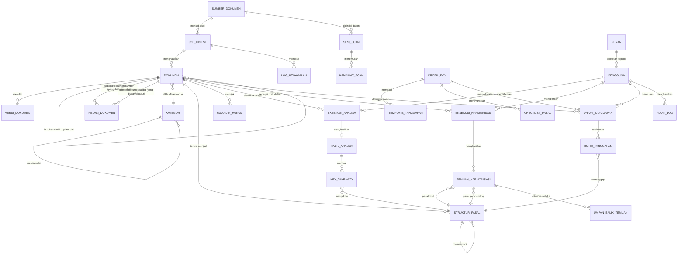

# DATA MODEL & DATA DICTIONARY
**Proyek:** HERO | **Versi:** 2.0 (Fase 2) | **Tanggal:** 3 November 2026 | **Penyusun:** Backend Engineering & System Architecture (Rafli)

> Dokumen ini menjelaskan **model data konseptual, logis, dan implementasi fisik** dari sudut pandang bisnis dan sistem HERO.
> Versi 2.0 ini memperbarui kamus data awal (Versi 1.1) dengan seluruh penyempurnaan skema database pada Fase 2 (Langkah 15–35b),
> mencakup deduplikasi identitas, hierarki lampiran, relasi keberlakuan peraturan, proteksi login brute-force, tata kelola draft kajian publik, serta statistik corong penyerapan dokumen.

---

## 1. Entity Relationship Diagram (ERD)

---

## 2. Data Dictionary

### 2.1 SUMBER_DOKUMEN (`scraping_sources`)
Daftar situs web, folder lokal, atau penyimpanan cloud yang menjadi sumber penyerapan regulasi.

| Atribut Logis | Kolom Fisik (DB) | Tipe Data | Wajib | Deskripsi | Aturan & Catatan |
|---|---|---|---|---|---|
| id_sumber | `id` | Integer (PK) | Ya | Pengenal unik sumber scraping | Auto-increment |
| nama | `name` | String(255) | Ya | Nama/label sumber yang dikenali pengguna | Contoh: JDIH OJK, Folder POJK 2026 |
| jenis_sumber | `source_type` | Enum (`JenisSumber`) | Ya | `situs_web`, `folder_lokal`, `onedrive_public` | Menentukan adapter crawler yang dipakai |
| alamat | `url` | String(500) | Ya | URL situs web atau path folder lokal | Unik; format valid sesuai jenis sumber |
| status_aktif | `is_active` | Boolean | Ya | Sumber aktif diikutsertakan pemindaian | Default: `true` |
| peran_dokumen_default | `default_document_role` | Enum (`PeranDokumen`) | Ya | `corpus_eksisting` atau `draft_kajian` | Default: `corpus_eksisting`. Kombinasi `draft_kajian` + `publik` ditolak 422 tanpa persetujuan (Langkah 35b) |
| klasifikasi_akses_default | `default_access_classification` | Enum (`KlasifikasiAkses`) | Ya | `publik`, `non_publik` | Default: `publik` untuk situs regulator umum |
| format_penamaan_default | `default_naming_format` | String(100) | Tidak | Urutan komponen nama berkas baku | Contoh: `nomor,jenis,tahun` |
| pemisah_penamaan_default | `default_naming_separator` | String(10) | Tidak | Karakter pemisah komponen nama berkas | Default: spasi (` `) |
| konfigurasi_tambahan | `custom_config` | JSONB / Text | Tidak | Parameter ekstra crawler/crawler adapter | Misal batas kedalaman crawl, selector CSS |
| tanggal_ditambahkan | `created_at` | DateTime (UTC) | Ya | Waktu registrasi sumber | `server_default=now()` |
| terakhir_dijalankan | `last_run_at` | DateTime (UTC) | Tidak | Waktu eksekusi crawl/scan terakhir | Diperbarui otomatis saat job selesai |

---

### 2.2 JOB_INGEST (`job_ingest`)
Catatan satu sesi eksekusi pengumpulan dan penyerapan dokumen ke dalam sistem.

| Atribut Logis | Kolom Fisik (DB) | Tipe Data | Wajib | Deskripsi | Aturan & Catatan |
|---|---|---|---|---|---|
| id_job | `id` | Integer (PK) | Ya | Pengenal unik pekerjaan ingest | Auto-increment |
| id_sumber | `source_id` | Integer (FK) | Tidak | Sumber dokumen yang diproses | FK → `scraping_sources.id`; kosong untuk unggah manual |
| jenis_job | `job_type` | Enum (`JenisJobIngest`) | Ya | `scraping`, `unggah_manual`, `sinkron_folder` | Menandai jalur asal perolehan dokumen |
| dipicu_oleh | `triggered_by` | String(100) | Ya | Identitas pengguna atau `"system"` | Merekam akuntabilitas pemrakarsa |
| referensi_sumber | `source_ref` | String(255) | Tidak | Label rujukan batch / nama berkas / sesi | Contoh: `system:placement`, `scan:sesi-12` |
| status | `status` | Enum (`StatusJobIngest`) | Ya | `antrian`, `berjalan`, `selesai`, `gagal` | Default: `antrian` |
| jumlah_total | `total_files` | Integer | Ya | Total berkas yang diproses dalam job ini | Default: 0 |
| jumlah_berhasil | `success_count` | Integer | Ya | Jumlah dokumen yang sukses tersimpan di KB | Default: 0 |
| jumlah_duplikat | `duplicate_count` | Integer | Ya | Dokumen yang terdeteksi duplikat | Default: 0 |
| jumlah_gagal | `failed_count` | Integer | Ya | Jumlah berkas yang gagal diproses | Default: 0 |
| waktu_mulai | `started_at` | DateTime (UTC) | Ya | Waktu pekerjaan mulai dieksekusi | — |
| waktu_selesai | `completed_at` | DateTime (UTC) | Tidak | Waktu pekerjaan tuntas | Kosong selama status `berjalan` |

---

### 2.3 DOKUMEN (`documents`)
Entitas inti repositori pengetahuan (*Knowledge Base*) regulasi HERO.

| Atribut Logis | Kolom Fisik (DB) | Tipe Data | Wajib | Deskripsi | Aturan & Catatan |
|---|---|---|---|---|---|
| id_dokumen | `id` | Integer (PK) | Ya | Pengenal unik dokumen regulasi | Auto-increment |
| judul | `title` | String(255) | Ya | Judul resmi peraturan | Diperiksa oleh pengaman ekstraksi `periksa_judul` (Langkah 35) |
| nomor_peraturan | `regulation_number` | String(100) | Tidak | Nomor resmi peraturan (misal: `11/POJK.03/2016`) | Wajib untuk penempatan otomatis kategori segmen |
| jenis_peraturan | `regulation_type` | String(50) | Tidak | Jenis regulasi (misal: `POJK`, `SEOJK`, `UU`, `PP`) | Menjadi folder segmen akar di KB |
| tahun_peraturan | `regulation_year` | Integer | Tidak | Tahun penetapan regulasi | Menjadi sub-folder tahun di KB |
| tanggal_terbit | `release_date` | Date | Tidak | Tanggal pengundangan/penetapan resmi | Tidak boleh melebihi tanggal hari ini |
| tanggal_berlaku | `effective_date` | Date | Tidak | Tanggal mulai berlakunya peraturan | Dipakai mengevaluasi status `belum_berlaku` |
| bidang | `bidang` | String(100) | Tidak | Sektor/bidang perbankan atau keuangan | Contoh: Perbankan Umum, BPR, Pasar Modal |
| status_keberlakuan | `status_keberlakuan` | Enum (`StatusKeberlakuan`) | Ya | `berlaku`, `diubah`, `dicabut`, `tidak_diketahui` | Dokumen dicabut **tidak dihapus** dari sistem (BRule-08) |
| klasifikasi_akses | `access_classification` | Enum (`KlasifikasiAkses`) | Ya | `publik`, `non_publik` | Non-publik dilindungi 403 saat `AUTH_ENABLED=false` |
| peran_dokumen | `document_role` | Enum (`PeranDokumen`) | Ya | `corpus_eksisting` atau `draft_kajian` | Draft kajian hanya dapat berstatus `publik` jika disetujui (Langkah 35) |
| id_kategori | `category_id` | Integer (FK) | Tidak | Folder penempatan dalam pohon kategori KB | FK → `categories.id` |
| kategori_manual | `kategori_manual` | Boolean | Ya | Penanda kategori dipilih manual oleh kurator | Default: `false`. Jika `true`, relokasi otomatis dilewati (Langkah 19, 33) |
| id_job | `job_id` | Integer (FK) | Tidak | Job ingest yang memasukkan berkas ini | FK → `job_ingest.id` |
| nama_berkas_asli | `original_filename` | String(255) | Tidak | Nama berkas saat diunggah/diunduh | — |
| nama_berkas_baku | `standardized_filename` | String(255) | Tidak | Nama hasil konvensi penamaan baku | Format: `<nomor> <judul> <tahun>.pdf` |
| jalur_berkas_pdf | `file_path_pdf` | String(500) | Ya | Lokasi path berkas fisik PDF di storage | Path relatif di bawah `storage/` |
| hash_berkas | `file_hash` | String(64) | Ya | Sidik jari SHA-256 berkas PDF | Deteksi duplikat byte identik (FR-SCR-08) |
| ukuran_berkas_byte | `file_size_bytes` | BigInteger | Ya | Ukuran fisik berkas dalam byte | Pasangan pembanding `file_hash` |
| jumlah_halaman | `page_count` | Integer | Tidak | Total jumlah halaman berkas PDF | Dihitung saat ingest |
| pdf_terproteksi | `pdf_terproteksi` | Boolean | Ya | Indikator PDF memiliki proteksi cetak/salin | Default: `false`. Diinspeksi otomatis (Langkah 27, 28) |
| url_sumber | `source_url` | String(1000) | Tidak | Alamat URL asal berkas diunduh | — |
| teks_lengkap | `full_text` | Text | Tidak | Teks utuh hasil ekstraksi dokumen | Disimpan untuk pencarian teks & analisa pasal |
| metode_ekstraksi | `extraction_method` | Enum (`MetodeEkstraksi`) | Tidak | `teks_langsung`, `ocr` | Menandai jalur ekstraksi teks |
| mesin_ekstraksi | `extraction_engine` | String(50) | Tidak | Mesin yang digunakan (misal: `pdfplumber`, `tesseract`) | — |
| keyakinan_ekstraksi | `extraction_confidence` | JSONB / Float | Tidak | Skor confidence hasil ekstraksi per field | Membantu kurasi metadata |
| status_pemrosesan | `processing_status` | Enum (`StatusPemrosesan`) | Ya | `diterima`, `diproses`, `perlu_koreksi`, `terindeks`, `gagal`, `ditolak` | Status siklus hidup dokumen |
| kunci_identitas | `identity_key` | String(100) | Tidak | Format: `<jenis>\|<nomor>\|<tahun>` (misal: `POJK\|11\|2016`) | Kunci identitas logis untuk deteksi duplikasi versi (Langkah 17) |
| id_duplikat_dari | `duplicate_of_id` | Integer (FK) | Tidak | Merujuk ID dokumen asli terdahulu di KB | FK → `documents.id` (Langkah 17, 30) |
| indikator_lampiran | `is_attachment` | Boolean | Ya | Menandai dokumen merupakan berkas lampiran | Default: `false` (Langkah 20, 21) |
| label_lampiran | `attachment_label` | String(100) | Tidak | Label rincian lampiran (misal: `"Lampiran I"`) | Diekstrak secara otomatis |
| id_dokumen_induk | `parent_document_id` | Integer (FK) | Tidak | ID dokumen regulasi induk dari lampiran ini | FK → `documents.id` (Langkah 20) |
| publik_disetujui_oleh | `publik_disetujui_oleh` | String(100) | Tidak | Nama pejabat/kurator yang menyetujui publikasi | Wajib bila `draft_kajian` + `publik` (Langkah 35, FR-SCR-04a) |
| publik_disetujui_alasan | `publik_disetujui_alasan` | Text | Tidak | Justifikasi persetujuan publikasi draft kajian | Wajib minimal 10 karakter (Langkah 35) |
| publik_disetujui_pada | `publik_disetujui_pada` | DateTime (UTC) | Tidak | Timestamp saat persetujuan publikasi disahkan | Waktu persetujuan resmi |
| terkoreksi_manual_pada | `metadata_corrected_at` | DateTime (UTC) | Tidak | Waktu metadata terakhir dikoreksi manual | Mencegah penimpaan oleh worker ML (Langkah 19, 35) |
| diekstraksi_pada | `extracted_at` | DateTime (UTC) | Tidak | Waktu penyelesaian ekstraksi teks & metadata | — |
| dibuat_pada | `created_at` | DateTime (UTC) | Ya | Waktu dokumen pertama kali masuk sistem | `server_default=now()` |
| diperbarui_pada | `updated_at` | DateTime (UTC) | Ya | Waktu terakhir pembaruan data dokumen | Diperbarui otomatis saat update |
| status_aktif | `is_active` | Boolean | Ya | Status aktif dokumen di sistem | Default: `true` (soft delete bila false) |

---

### 2.4 KATEGORI (`categories`)
Struktur hirarki folder Knowledge Base per jenis regulasi dan segmentasi tahun/sektor.

| Atribut Logis | Kolom Fisik (DB) | Tipe Data | Wajib | Deskripsi | Aturan & Catatan |
|---|---|---|---|---|---|
| id_kategori | `id` | Integer (PK) | Ya | Pengenal unik kategori | Auto-increment |
| nama_kategori | `name` | String(100) | Ya | Nama/label folder yang tampil di antarmuka | Misal: `POJK`, `2026`, `Perbankan` |
| id_induk | `parent_id` | Integer (FK) | Tidak | Kategori induk; bernilai `NULL` bila kategori akar | FK → `categories.id` |
| jalur_lengkap | `path` | String(500) | Ya | Path hirarki direktori penyimpanan fisik | Contoh: `POJK/2026/` |
| dibuat_otomatis | `auto_created` | Boolean | Ya | Dibuat otomatis oleh placement atau manual | Default: `false` |
| kunci_otomatis | `kunci_otomatis` | String(100) | Tidak | Kunci logis sistem penempatan permanen | Menjaga relokasi otomatis tetap permanen jika nama label di-rename kurator (Langkah 33, 33b) |
| deskripsi | `description` | Text | Tidak | Keterangan cakupan isi kategori | — |
| urutan_tampil | `sort_order` | Integer | Ya | Urutan urut folder di antarmuka web | Default: 0 |
| dibuat_pada | `created_at` | DateTime (UTC) | Ya | Waktu pembuatan kategori | — |

---

### 2.5 STRUKTUR_PASAL (`articles`)
Penguraian dokumen regulasi menjadi unit pasal, ayat, dan bab sebagai basis ketertelusuran granular.

| Atribut Logis | Kolom Fisik (DB) | Tipe Data | Wajib | Deskripsi | Aturan & Catatan |
|---|---|---|---|---|---|
| id_pasal | `id` | Integer (PK) | Ya | Pengenal unik unit pasal | Auto-increment |
| id_dokumen | `document_id` | Integer (FK) | Ya | Dokumen regulasi induk | FK → `documents.id` (Langkah 13, 35) |
| nomor_pasal | `article_number` | String(50) | Ya | Nomor pasal (misal: `"Pasal 1"`, `"Pasal 5A"`) | Unit terkecil analisa harmonisasi |
| judul_bab | `chapter_title` | String(255) | Tidak | Nama bab / judul bagian bila ada | Contoh: `"BAB I KETENTUAN UMUM"` |
| isi_teks | `content` | Text | Ya | Teks lengkap isi pasal apa adanya | Tanpa parafrase (KEP-08) |
| urutan | `order_index` | Integer | Ya | Nomor urut letak pasal dalam dokumen | Default: 0 |
| dibuat_pada | `created_at` | DateTime (UTC) | Ya | Waktu ekstraksi pasal tersimpan | `server_default=now()` |

---

### 2.6 RELASI_DOKUMEN (`document_relations`)
Merekam hubungan yuridis antar-peraturan perundang-undangan (mengubah, mencabut, melengkapi).

| Atribut Logis | Kolom Fisik (DB) | Tipe Data | Wajib | Deskripsi | Aturan & Catatan |
|---|---|---|---|---|---|
| id_relasi | `id` | Integer (PK) | Ya | Pengenal unik relasi peraturan | Auto-increment (Langkah 20, 21) |
| id_dokumen_sumber | `source_document_id` | Integer (FK) | Ya | Dokumen yang membawa ketentuan baru | FK → `documents.id` (dokumen pengubah/pencabut) |
| id_dokumen_target | `target_document_id` | Integer (FK) | Ya | Dokumen yang terkena dampak yuridis | FK → `documents.id` (dokumen yang diubah/dicabut) |
| jenis_relasi | `relation_type` | Enum (`JenisRelasi`) | Ya | `mengubah`, `mencabut`, `terkait`, `melengkapi` | Menjadi dasar penentuan `status_keberlakuan` |
| deskripsi | `description` | Text | Tidak | Catatan pasal-pasal spesifik yang diganti | Contoh: `"Mengubah Pasal 4 dan Pasal 12"` |
| dibuat_pada | `created_at` | DateTime (UTC) | Ya | Waktu relasi dicatat di sistem | `server_default=now()` |

---

### 2.7 PERCOBAAN_LOGIN (`percobaan_login`)
Mitigasi serangan brute-force login dan pencatatan state lockout keamanan (Langkah 34 & 34b).

| Atribut Logis | Kolom Fisik (DB) | Tipe Data | Wajib | Deskripsi | Aturan & Catatan |
|---|---|---|---|---|---|
| id_percobaan | `id` | Integer (PK) | Ya | Pengenal unik catatan percobaan | Auto-increment |
| kunci | `kunci` | String(100) | Ya | Kunci pelacakan lockout | Format: `u:<username>` untuk akun, `ip:<ip>` untuk alamat IP. Unik (Langkah 34b) |
| jumlah_gagal | `jumlah_gagal` | Integer | Ya | Akumulasi kesalahan password dalam jendela | Default: 0 |
| jendela_mulai | `jendela_mulai` | DateTime (UTC) | Ya | Titik awal perhitungan akumulasi kegagalan | Direset bila melampaui `LOGIN_JENDELA_MENIT` |
| terkunci_sampai | `terkunci_sampai` | DateTime (UTC) | Tidak | Batas waktu lockout aktif | Bila waktu sekarang < nilai ini, login ditolak 423 |
| diperbarui | `diperbarui` | DateTime (UTC) | Ya | Waktu terakhir entri diperbarui | Diperbarui pada setiap percobaan |

---

### 2.8 SESI_SCAN & KANDIDAT_SCAN (`scan_sessions` & `scan_candidates`)
Mendukung perhitungan real-time **Statistik Corong Penyerapan Dokumen** (Langkah 27 & 31).

**SESI_SCAN (`scan_sessions`)**
| Atribut Logis | Kolom Fisik (DB) | Tipe Data | Wajib | Deskripsi | Aturan & Catatan |
|---|---|---|---|---|---|
| id_sesi | `id` | Integer (PK) | Ya | Pengenal unik sesi pemindaian scraper | Auto-increment |
| id_sumber | `source_id` | Integer (FK) | Ya | Sumber regulasi yang dipindai | FK → `scraping_sources.id` |
| status | `status` | Enum (`StatusScan`) | Ya | `berjalan`, `siap_dipilih`, `selesai`, `gagal` | Menandai kesiapan hasil pemindaian |
| jumlah_kandidat | `total_candidates` | Integer | Ya | Total tautan/file yang ditemukan scraper | Dihitung saat crawl tuntas |
| waktu_mulai | `started_at` | DateTime (UTC) | Ya | Waktu pemindaian dimulai | — |
| waktu_selesai | `completed_at` | DateTime (UTC) | Tidak | Waktu pemindaian berakhir | — |

**KANDIDAT_SCAN (`scan_candidates`)**
| Atribut Logis | Kolom Fisik (DB) | Tipe Data | Wajib | Deskripsi | Aturan & Catatan |
|---|---|---|---|---|---|
| id_kandidat | `id` | Integer (PK) | Ya | Pengenal berkas kandidat hasil scan | Auto-increment |
| id_sesi | `session_id` | Integer (FK) | Ya | Sesi pemindaian asal kandidat | FK → `scan_sessions.id` |
| judul | `title` | Text | Tidak | Judul regulasi terdeteksi dari tautan/metadata | — |
| url_sumber | `source_url` | String(1000) | Ya | URL unduhan langsung berkas PDF | — |
| status_penarikan | `status` | String(50) | Ya | `belum_ditarik`, `ditarik`, `dilewati` | Penentu tahapan corong (Langkah 27, 31) |
| id_dokumen_kb | `document_id` | Integer (FK) | Tidak | ID dokumen setelah berhasil ditarik ke KB | FK → `documents.id` |

---

### 2.9 EKSEKUSI_ANALISA & HASIL_ANALISA (`analysis_runs` & `analysis_results`)
Pengelolaan siklus analisa regulasi dan penyimpanan cache hasil perbandingan Knowledge Base.

| Atribut Logis | Kolom Fisik (DB) | Tipe Data | Wajib | Deskripsi | Aturan & Catatan |
|---|---|---|---|---|---|
| id_analisa | `id` | Integer (PK) | Ya | Pengenal eksekusi analisa | Auto-increment |
| id_dokumen | `document_id` | Integer (FK) | Ya | Dokumen regulasi yang dianalisa | FK → `documents.id` |
| mode_analisa | `analysis_mode` | Enum | Ya | `deterministik`, `ai_assisted` | Default: `deterministik` (BRule-02) |
| data_ringkasan | `summary_data` | JSONB / Text | Tidak | Ringkasan pokok perubahan & statistik pasal | Menampilkan breakdown pasal |
| data_temuan | `findings_data` | JSONB / Text | Ya | Array temuan komparasi per pasal | Menyimpan status: baru, sama, menggantikan, melengkapi |
| usang_sejak | `usang_sejak` | DateTime (UTC) | Tidak | Penanda invalidasi cache analisa | Diisi saat dokumen diubah / dikoreksi (Langkah 25, 35) |
| alasan_usang | `alasan_usang` | Text | Tidak | Alasan cache diinvalidasi | Contoh: `"perubahan_metadata"`, `"koreksi_draft"` |
| dibuat_pada | `created_at` | DateTime (UTC) | Ya | Waktu hasil analisa di-generate | — |

---

### 2.10 PENGGUNA, PERAN & AUDIT_LOG (`users` & `audit_logs`)

**PENGGUNA (`users`)**
| Atribut Logis | Kolom Fisik (DB) | Tipe Data | Wajib | Deskripsi |
|---|---|---|---|---|
| id_pengguna | `id` | Integer (PK) | Ya | Pengenal unik pengguna |
| username | `username` | String(50) | Ya | Nama akun pengguna (unik) |
| hash_password | `hashed_password` | String(255) | Ya | Hash kata sandi aman (bcrypt) |
| peran | `role` | Enum (`PeranPengguna`) | Ya | `admin_kb`, `analis`, `auditor`, `peninjau` |
| status_aktif | `is_active` | Boolean | Ya | Penanda akun aktif atau dinonaktifkan |
| dibuat_pada | `created_at` | DateTime (UTC) | Ya | Waktu pendaftaran akun |

**AUDIT_LOG (`audit_logs`)**
| Atribut Logis | Kolom Fisik (DB) | Tipe Data | Wajib | Deskripsi |
|---|---|---|---|---|
| id_log | `id` | Integer (PK) | Ya | Pengenal catatan audit log |
| id_pengguna | `user_id` | Integer (FK) | Tidak | Pelaku aksi (kosong bila pemicu sistem / anonim) |
| aksi | `action` | String(50) | Ya | Kode aksi (misal: `UPLOAD_DOCUMENT`, `PUBLIKASI_DRAFT`, `LOGIN_LOCKED`) |
| entitas_sasaran | `target_resource` | String(100) | Tidak | Sumber daya yang dikenai aksi (misal: `document:95`, `source:3`) |
| rincian_aksi | `detail` | JSONB / Text | Ya | Metadata diff, alasan perubahan, atau snapshot persetujuan |
| alamat_ip | `ip_address` | String(45) | Tidak | Alamat IP pemanggil aksi |
| waktu | `created_at` | DateTime (UTC) | Ya | Timestamp kejadian (UTC) |

---

### 2.11 LOG_KEGAGALAN (`ingest_failures`)
Pencatatan antrean dokumen yang ditolak atau mengalami kesalahan penyerapan (Failure Queue).

| Atribut Logis | Kolom Fisik (DB) | Tipe Data | Wajib | Deskripsi |
|---|---|---|---|---|
| id_kegagalan | `id` | Integer (PK) | Ya | Pengenal unik catatan kegagalan |
| id_job | `job_id` | Integer (FK) | Tidak | Pekerjaan ingest terkait |
| id_dokumen | `document_id` | Integer (FK) | Tidak | Dokumen terkait bila kegagalan terjadi di tahap pasca-unggah |
| nama_berkas_asli | `original_filename` | String(255) | Ya | Nama berkas yang mengalami kendala |
| tipe_kegagalan | `failure_type` | Enum (`JenisKegagalan`) | Ya | `format_tidak_didukung`, `duplikat`, `ekstraksi_gagal`, `ocr_gagal`, `kesalahan_internal` |
| kode_alasan | `reason_code` | String(100) | Ya | Kode mesin error (misal: `penempatan_gagal`, `teks_kosong_ocr`) |
| pesan_kesalahan | `message` | Text | Ya | Deskripsi detail kendala untuk kurator manusia |
| dapat_diulang | `is_retryable` | Boolean | Ya | Penanda apakah berkas dapat di-retry otomatis |
| status_tindak_lanjut | `follow_up_status` | Enum (`StatusTindakLanjut`) | Ya | `belum_ditangani`, `diproses_ulang`, `diabaikan` |
| dibuat_pada | `created_at` | DateTime (UTC) | Ya | Waktu pencatatan kegagalan |

---

## 3. Catatan Arsitektur & Aturan Bisnis Penting (Fase 2)

1. **Deduplikasi Ganda (Byte Identik & Kunci Identitas):**
   * Pemeriksaan duplikat dilakukan pada dua lapisan: pasangan `file_hash` + `file_size_bytes` (berkas identik) dan `identity_key` (peraturan sama dari sumber berbeda).
   * Bila ditemukan, berkas kedua tidak dibuat ganda di KB, melainkan dicatat dengan `duplicate_of_document_id`.
2. **Kategori Penempatan Permanen (`kunci_otomatis`):**
   * Penamaan folder segmen (seperti `POJK`, `SEOJK`, `UU`, `PP`) memiliki `kunci_otomatis` yang tidak berubah. Kurator bebas mengubah label nama folder di UI tanpa mematahkan logika penempatan otomatis berkas baru.
3. **Pemisahan Ketat Draft Kajian & Regulasi Publik (Langkah 35 & 35b):**
   * Dokumen berstatus `draft_kajian` secara default berklasifikasi `non_publik` guna melindungi kerahasiaan kebijakan (NDA).
   * Publikasi ke ranah `publik` mewajibkan persetujuan kurator yang berwenang (`publik_disetujui_oleh`) beserta alasan tertulis minimal 10 karakter (`publik_disetujui_alasan`).
4. **Pencegahan Judul Merusak (Pengaman Ekstraksi Judul):**
   * Ekstraksi judul oleh worker ML dibatasi oleh filter penanda isi pasal (`Menimbang`, `Mengingat`, `BAB I`, `Pasal 1`, dll.) dan panjang kolom fisik database (255 karakter) agar judul tidak menelan teks pasal regulasi.
5. **Mitigasi Brute Force (Tabel `percobaan_login`):**
   * Pembatasan percobaan login salah password diterapkan pada level akun (`u:<username>`) dan level IP jaringan (`ip:<ip>`) dengan jendela waktu dan durasi lockout dinamis.

---

## Riwayat Revisi Dokumen

| Versi | Tanggal | Perubahan | Penyusun |
|---|---|---|---|
| 1.0 | 7 Sep 2026 | Draft awal: ERD 20 entitas + data dictionary konseptual | BA |
| 1.1 | 8 Sep 2026 | Penyesuaian klasifikasi temuan harmonisasi dan atribut ukuran berkas | BA |
| **2.0** | **3 Nov 2026** | **Pembaruan Menyeluruh Fase 2 (Langkah 15–35b):** - Penambahan atribut DOKUMEN: `identity_key`, `duplicate_of_document_id`, `kategori_manual`, `pdf_terproteksi`, `publik_disetujui_*`, `metadata_corrected_at`, `is_attachment`, `parent_document_id`, `attachment_label`, `page_count`. - Penambahan atribut KATEGORI: `kunci_otomatis` permanen. - Penambahan atribut SUMBER_DOKUMEN: default peran, klasifikasi akses, dan aturan penamaan. - Penambahan entitas baru: `RELASI_DOKUMEN` (`document_relations`), `PERCOBAAN_LOGIN` (`percobaan_login`), serta `SESI_SCAN` & `KANDIDAT_SCAN` untuk corong penyerapan data. | Backend Engineering (Rafli) |
