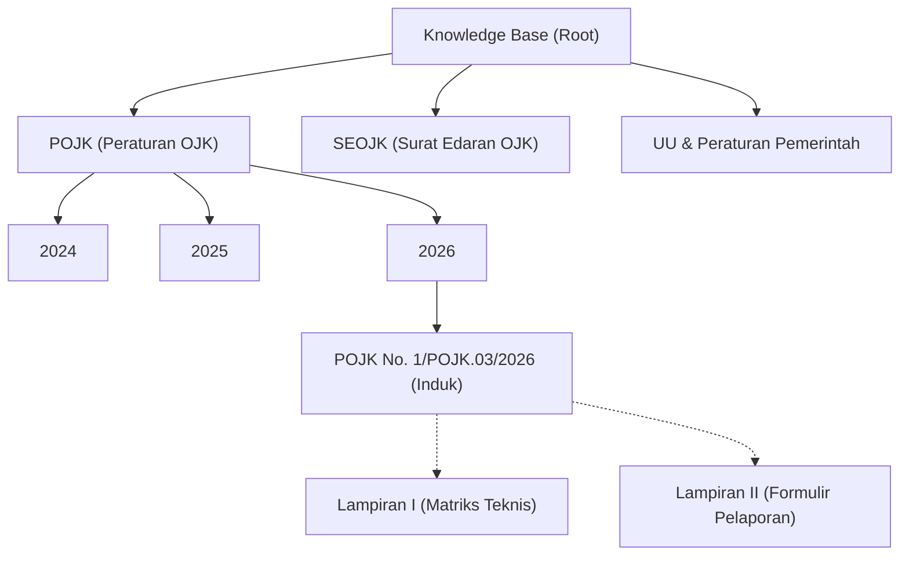
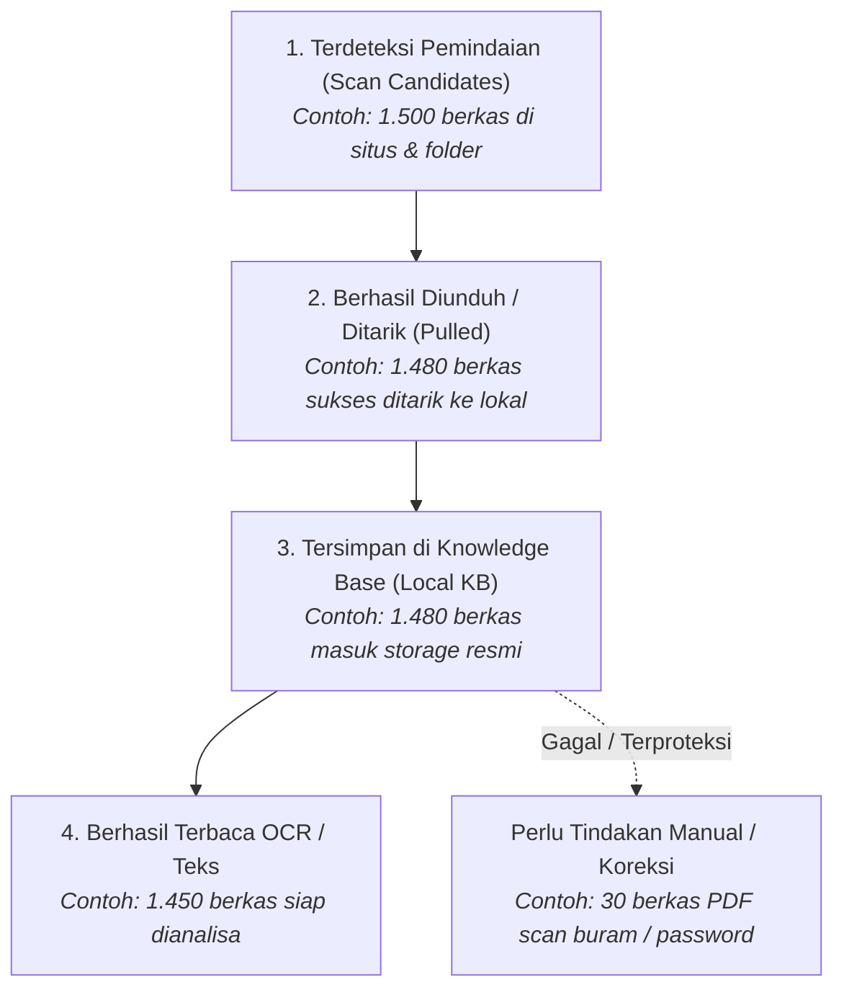
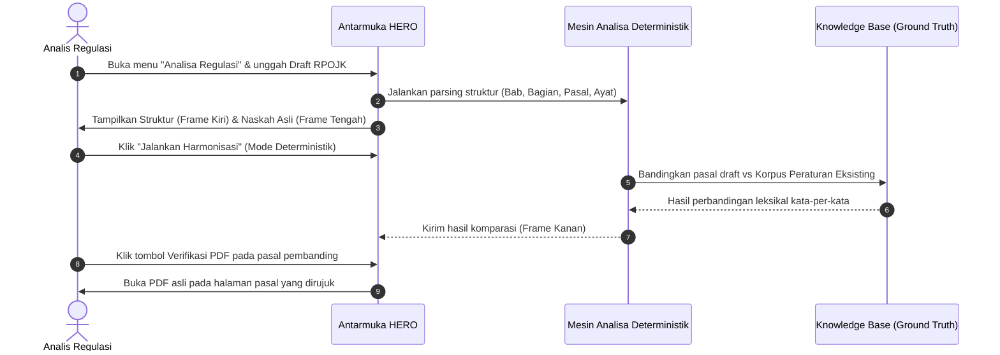

# PANDUAN PENGGUNA SISTEM HERO (USER GUIDE & FAQ)
**Harmonization & Evaluation of Regulatory Operations**  
**Versi:** 2.0 (Fase 2 MVP) | **Tanggal:** 3 November 2026 | **Penyusun:** Tim Produk HERO (DPEA OJK & Project Team)  
**Tujuan Dokumen:** Memenuhi persyaratan pengujian **TC-59 (Usability Alur Utama UAT)** dan **TC-60 (Kelengkapan Dokumentasi Teknis & Panduan Pengguna)**.

---

## DAFTAR ISI
1. [Pengenalan HERO & Konsep Inti](#1-pengenalan-hero--konsep-inti)
2. [Navigasi & Pencarian di Knowledge Base](#2-navigasi--pencarian-di-knowledge-base)
3. [Penyerapan Dokumen & Membaca Statistik Corong](#3-penyerapan-dokumen--membaca-statistik-corong)
4. [Alur Unggah Dokumen & Tata Kelola Draft Kajian](#4-alur-unggah-dokumen--tata-kelola-draft-kajian)
5. [Alur Analisa Regulasi & Harmonisasi Per Pasal (Panduan UAT TC-59)](#5-alur-analisa-regulasi--harmonisasi-per-pasal-panduan-uat-tc-59)
6. [Penyusunan Draft Tanggapan (PoV) & Ekspor Hasil](#6-penyusunan-draft-tanggapan-pov--ekspor-hasil)
7. [Tanya Jawab (FAQ) & Panduan Penanganan Kendala](#7-tanya-jawab-faq--panduan-penanganan-kendala)

---

## 1. PENGENALAN HERO & KONSEP INTI

### 1.1 Apa itu HERO?
**HERO (Harmonization & Evaluation of Regulatory Operations)** adalah platform otomasi analisis regulasi perbankan dan jasa keuangan. Sistem ini membantu analis kebijakan dan tim hukum menelaah rancangan peraturan baru (draft kajian/RPOJK) secara cepat dan teliti dengan membandingkannya terhadap seluruh korpus peraturan yang sudah berlaku.

### 1.2 Tiga Pilar Operasional HERO
1. **Knowledge Base sebagai *Single Source of Truth* (Ground Truth):**
   Seluruh regulasi resmi yang telah dirilis oleh OJK dan regulator terkait dikumpulkan secara otomatis (melalui web scraping, sinkronisasi OneDrive, atau folder lokal) dan diproses ke dalam database vektor dan tabel terstruktur. Tanpa Knowledge Base yang lengkap, analisa tidak memiliki landasan fakta.
2. **Dual Mode Analisa (Deterministik Wajib + AI-Assisted Opsional):**
   - **Mode Deterministik (Default & Wajib):** Berjalan dengan aturan logika baku dan perbandingan leksikal (*letterlijk* / kata demi kata). Sistem ini 100% mandiri dan tetap beroperasi normal meskipun layanan AI eksternal sedang mati (*offline*).
   - **Mode AI-Assisted (Opsional):** Memberikan ringkasan eksekutif dan rekomendasi kontekstual. AI dipasangi **guardrail ketat**: dilarang berasumsi atau memberikan pendapat di luar fakta yang tercantum di Knowledge Base internal (*anti-halusinasi*).
3. **Akuntabilitas & Watermark "Draft / Rekomendasi":**
   Semua ringkasan, perbandingan pasal, dan draf tanggapan yang dihasilkan oleh sistem otomatis selalu berlabel **"Draft / Rekomendasi"** (termasuk pada file ekspor) untuk menegaskan bahwa keputusan hukum akhir tetap berada di tangan pejabat/analis manusia (*human-in-the-loop*).

---

## 2. NAVIGASI & PENCARIAN DI KNOWLEDGE BASE

Knowledge Base (KB) memuat seluruh arsip peraturan yang tersusun rapi menurut hierarki hukum dan klasifikasinya.

### 2.1 Menjelajah Pohon Kategori
1. Buka menu **Knowledge Base** pada panel navigasi sebelah kiri.
2. Pada panel direktori, klik tanda panah `>` di samping jenis peraturan (misal: `POJK` → `2026`).
3. Folder kategori yang dibuat otomatis oleh sistem memiliki label baku. Jika kurator telah mengoreksi atau mengubah susunan kategori secara manual (`kategori_manual = true`), sistem penempatan otomatis tidak akan menimpa pilihan tersebut.

### 2.2 Pencarian & Filter Regulasi
Gunakan bilah pencarian di bagian atas tabel dokumen untuk menyaring arsip:
- **Kata Kunci Judul / Teks:** Masukkan istilah spesifik, misal: `"Tata Kelola Perbankan"`, `"Modal Inti"`.
- **Nomor Peraturan:** Masukkan format resmi, misal: `11/POJK.03/2016`.
- **Status Keberlakuan:**
  - 🟢 **Berlaku:** Peraturan saat ini aktif berlaku penuh.
  - 🟠 **Diubah:** Sebagian pasal telah digantikan oleh peraturan yang lebih baru.
  - 🔴 **Dicabut:** Seluruh ketentuan peraturan sudah tidak berlaku (catatan: dokumen lama tetap tersimpan untuk riwayat ketertelusuran).
  - ⚪ **Belum Berlaku:** Peraturan sudah diundangkan namun tanggal efektifnya (`effective_date`) belum tiba.

### 2.3 Memeriksa Dokumen Lampiran & Riwayat Versi
- **Dokumen Lampiran:** Jika suatu regulasi memiliki lampiran tersendiri (seperti matriks penghitungan atau format formulir), dokumen lampiran akan tampil di bawah dokumen induk dengan label khusus (`Lampiran I`, `Lampiran II`).
- **Riwayat Versi:** Jika dokumen yang sama mengalami perbaikan teks atau metadata, klik tab **Riwayat Versi** pada detail dokumen untuk melihat daftar revisi terdahulu.

---

## 3. PENYERAPAN DOKUMEN & MEMBACA STATISTIK CORONG

Untuk memastikan seluruh 1.500+ dokumen peraturan (dari situs JDIH OJK, situs sekunder, dan folder OneDrive) terserap sempurna, HERO menyediakan instrumen pemantauan real-time berupa **Statistik Corong (Funnel)**.

### 3.1 Membaca Diagram Corong Penyerapan

Pada menu **Dashboard > Statistik Corong**:
1. **Terdeteksi Pemindaian:** Jumlah total tautan/berkas PDF yang ditemukan oleh spider scraper pada sumber target.
2. **Berhasil Ditarik:** Berkas yang sukses diunduh tanpa kendala koneksi atau korupsi transmisi.
3. **Tersimpan di Knowledge Base:** Berkas yang lolos verifikasi integritas, lolos deduplikasi SHA-256/kunci identitas, dan berhasil ditempatkan pada folder kategori.
4. **Terbaca OCR / Teks Langsung:** Dokumen yang seluruh teks pasalnya berhasil diekstraksi ke dalam penyimpanan terstruktur dan vektor.

### 3.2 Menangani Dokumen yang Macet di Corong
Jika angka pada tahap 4 lebih kecil dari tahap 3:
- Buka submenu **Dokumen Bermasalah / Perlu Koreksi**.
- Dokumen dengan badge **PDF Terproteksi** menandakan berkas memiliki proteksi cetak/enkripsi password dari penerbit asli sehingga teks tidak dapat disalin otomatis. Kurator dapat membuka berkas secara manual dan mengunggah teks hasil kurasi.
- Dokumen dengan badge **OCR Gagal / Teks Kosong** biasanya merupakan pindaian fisik lama (*scanned hard copy*). Dokumen ini dapat diproses ulang dengan tombol **Ekstraksi Ulang (OCR Deep Scan)**.

---

## 4. ALUR UNGGAH DOKUMEN & TATA KELOLA DRAFT KAJIAN

### 4.1 Pembedaan Peran Dokumen
Saat mengunggah berkas regulasi baru, pengguna wajib menentukan **Peran Dokumen**:
1. **Corpus Eksisting (`corpus_eksisting`):**
   - Dokumen peraturan final yang sudah resmi berlaku.
   - Otomatis berstatus **Publik** dan langsung menjadi bagian dari basis komparasi Knowledge Base.
2. **Draft Kajian (`draft_kajian`):**
   - RPOJK, naskah akademis, atau rancangan surat edaran yang sedang ditelaah.
   - Sesuai prinsip kerahasiaan dan kepatuhan NDA, draf kajian **wajib berstatus Non-Publik secara default**.

### 4.2 Prosedur & Pengaman Persetujuan Publikasi Draft (Langkah 35 & 35b)
Jika suatu draft kajian hendak dipublikasikan secara terbuka:

> [!IMPORTANT]
> Sistem menerapkan proteksi otomatis pada antarmuka dan backend:
> 1. Field **Persetujuan Publikasi** wajib diisi:
>    - **Nama Pejabat / Kurator Penyetujui (`publik_disetujui_oleh`)**: Minimal nama lengkap penanggung jawab.
>    - **Alasan / Justifikasi Persetujuan (`publik_disetujui_alasan`)**: Minimal 10 karakter (misal: *"Telah disetujui Direktur DPEA untuk konsultasi publik"*).
> 2. **Pengaman Pusat Backend:** Jika opsi `draft_kajian` + `publik` dikirim tanpa persetujuan lengkap, sistem **tidak akan menggagalkan unggah**, melainkan **secara otomatis menurunkan klasifikasinya menjadi `non_publik`** demi menjaga kepatuhan NDA, dan mencatat insiden tersebut di Audit Log.

---

## 5. ALUR ANALISA REGULASI & HARMONISASI PER PASAL (PANDUAN UAT TC-59)

Skenario ini merupakan alur utama pengujian UAT bagi analis baru untuk menelaah naskah draft per pasal tanpa bantuan teknis.

### Langkah-langkah Pengujian Alur Utama (TC-59):

#### Langkah 1: Membuka Modul Analisa
1. Klik menu **Analisa Regulasi** pada navigasi utama.
2. Pilih tab **Harmonisasi Draft Baru**.

#### Langkah 2: Memilih Dokumen Draft
1. Klik tombol **Pilih Dokumen Draft**.
2. Pilih file RPOJK uji (misal: `RPOJK_Penyelenggaraan_BPR_2026.pdf`).
3. Pastikan mode analisa berada pada posisi default: **Deterministik**.

#### Langkah 3: Memahami Tata Letak Tiga Frame (*Three-Pane Layout*)
Setelah draft dimuat, layar terbagi menjadi tiga bingkai kerja:
- **Bingkai Kiri (Navigasi Struktur):** Daftar bab, pasal, dan ayat yang terurai dari draft naskah. Klik salah satu pasal (misal: `Pasal 4`) untuk fokus pada pasal tersebut.
- **Bingkai Tengah (Naskah Draft Asli):** Menampilkan teks asli bunyi pasal yang sedang dipilih apa adanya tanpa perubahan redaksi.
- **Bingkai Kanan (Hasil Harmonisasi & Komparasi):** Menampilkan status temuan komparasi terhadap peraturan di Knowledge Base.

#### Langkah 4: Membaca 4 Kategori Hasil Analisa per Pasal
Setiap pasal yang dianalisa akan memiliki salah satu dari empat label status:
1. 🟢 **Baru:**
   - **Artinya:** Ketentuan pasal ini sama sekali belum pernah diatur dalam peraturan mana pun di Knowledge Base.
   - **Tindakan Analis:** Periksa apakah norma baru ini memerlukan aturan turunan atau berpotensi tumpang tindih dengan kewenangan lembaga lain.
2. 🔵 **Sama:**
   - **Artinya:** Bunyi pasal ini persis sama (*letterlijk*) dengan pasal pada peraturan eksisting, atau dokumen yang sama diunggah berulang kali.
   - **Tindakan Analis:** Evaluasi apakah pengulangan norma ini disengaja untuk penegasan atau merupakan redundansi hukum.
3. 🟠 **Menggantikan:**
   - **Artinya:** Pasal ini merevisi, memperbarui, atau mencabut klausul pada peraturan lama (misal: POJK Perubahan menggantikan syarat modal di POJK sebelumnya). Pasal lama otomatis terdeteksi tidak berlaku lagi.
   - **Tindakan Analis:** Pastikan pasal lama yang terdampak tercantum secara akurat pada klausul peralihan.
4. 🟣 **Melengkapi:**
   - **Artinya:** Norma baru ini memperluas, merinci, atau mengatur petunjuk teknis lebih lanjut atas pasal yang sudah ada tanpa membatalkan bunyi pasal lama.
   - **Tindakan Analis:** Pastikan tidak ada kontradiksi operasional antara aturan pelengkap dan aturan induk.

#### Langkah 5: Verifikasi Fakta via Hyperlink PDF Sumber
Sesuai arahan integritas DPEA, sistem **wajib menyediakan bukti autentik** agar analis manusia dapat memverifikasi temuan sistem secara langsung:
1. Pada kartu temuan di Bingkai Kanan (misal: *"Pasal 4 menggantikan POJK No. 7 Tahun 2024 Pasal 3"*), perhatikan tombol/ikon **Lihat PDF Sumber**.
2. Klik tautan tersebut. Sistem akan membuka berkas PDF asli peraturan pembanding dalam tab baru langsung mengarah ke halaman yang memuat pasal terkait.
3. Analis dapat membandingkan teks draft dengan teks peraturan asli berdampingan.

---

## 6. PENYUSUNAN DRAFT TANGGAPAN (POV) & EKSPOR HASIL

Setelah proses harmonisasi selesai ditelaah:
1. Klik tombol **Buat Draft Tanggapan (PoV)** pada sudut kanan atas.
2. **Pilih Profil Sudut Pandang (PoV):**
   - Misal: *Sudut Pandang Pengawasan Perbankan*, *Sudut Pandang Perlindungan Konsumen*, atau *Sudut Pandang Kepatuhan & Hukum*.
3. Sistem akan memuat template checklist dan butir komentar standar sesuai sudut pandang yang dipilih.
4. Analis dapat menyunting narasi rekomendasi pada kolom yang disediakan.
5. Klik **Ekspor Tanggapan**:
   - Pilih format: **DOCX** (untuk pembahasan lanjutan) atau **PDF** (untuk laporan resmi).
   - Seluruh berkas ekspor secara otomatis memuat watermark dan catatan kaki: **`"Draft / Rekomendasi — Dihasilkan melalui Sistem HERO"`**.

---

## 7. TANYA JAWAB (FAQ) & PANDUAN PENANGANAN KENDALA

### Q1: Dokumen saya macet di status `perlu_koreksi`, apa penyebabnya?
> **Jawaban:** Status `perlu_koreksi` muncul jika:
> - Format judul atau nomor peraturan tidak sesuai konvensi standar (misal nomor peraturan tertulis salah di berkas asli).
> - Dokumen merupakan berkas PDF hasil fotokopi/pindaian buram sehingga teks pasal tidak terbaca utuh.
> - **Solusi:** Klik tombol **Koreksi Metadata**, lengkapi nomor dan judul peraturan secara manual, lalu klik **Simpan & Proses Ulang**. Penempatan manual kurator akan dikunci (`kategori_manual = true`) sehingga tidak akan diubah kembali oleh bot.

### Q2: Mengapa dokumen dengan badge `PDF Terproteksi` tidak bisa disalin teksnya?
> **Jawaban:** Beberapa regulator menerbitkan PDF dengan proteksi enkripsi izin (*permission restriction*) yang melarang penyalinan teks (*copy text*). 
> - **Solusi:** Sistem HERO tetap menyimpan berkas tersebut di storage lokal dan menandainya dengan badge `pdf_terproteksi = true`. Tim kurator dapat menggunakan fitur **Bypass OCR Rekonstruksi** untuk mengekstrak naskah melalui pembacaan gambar tingkat lanjut.

### Q3: Mengapa draft kajian yang saya unggah sebagai Publik tiba-tiba berubah menjadi Non-Publik?
> **Jawaban:** Demi kepatuhan NDA dan kerahasiaan kebijakan, seluruh draft kajian berstatus publik wajib disertai identitas pejabat penyetujui dan alasan tertulis minimal 10 karakter. Jika kolom ini dikosongkan, sistem keselamatan pusat (*fail-safe*) HERO otomatis mengalihkan status berkas menjadi `non_publik` agar tidak dapat diunduh pihak luar.

### Q4: Apakah sistem tetap bisa digunakan jika layanan AI (LLM) sedang offline?
> **Jawaban:** **Ya, 100% tetap bisa digunakan.** HERO dirancang dengan prinsip *Deterministic-First*. Modul ekstraksi, perbandingan pasal *letterlijk*, penentuan status (Baru, Sama, Menggantikan, Melengkapi), dan verifikasi PDF berjalan penuh di mesin lokal tanpa ketergantungan pada koneksi AI eksternal (memenuhi target skenario TC-53).

### Q5: Bagaimana kebijakan hak akses dan login saat ini?
> **Jawaban:**
> - **Fase 1 / UAT Publik:** Sistem berjalan dengan `AUTH_ENABLED=false` untuk memudahkan verifikasi fungsional oleh pengguna pilot tanpa hambatan akun. Namun, proteksi dokumen sensitif tetap aktif: dokumen `non_publik` dilindungi kode status 403.
> - **Fase 2 / Production:** Sistem dilengkapi fitur RBAC penuh (`AUTH_ENABLED=true`), manajemen peran (`admin_sistem`, `admin_kb`, `analis`, `pembaca`), proteksi brute-force login (`percobaan_login`), serta tata kelola izin publikasi draft kajian.

---
*Dokumen ini merupakan bagian dari paket kelengkapan UAT Milestone 2 (M-11 & M-12) Proyek HERO DPEA OJK.*

